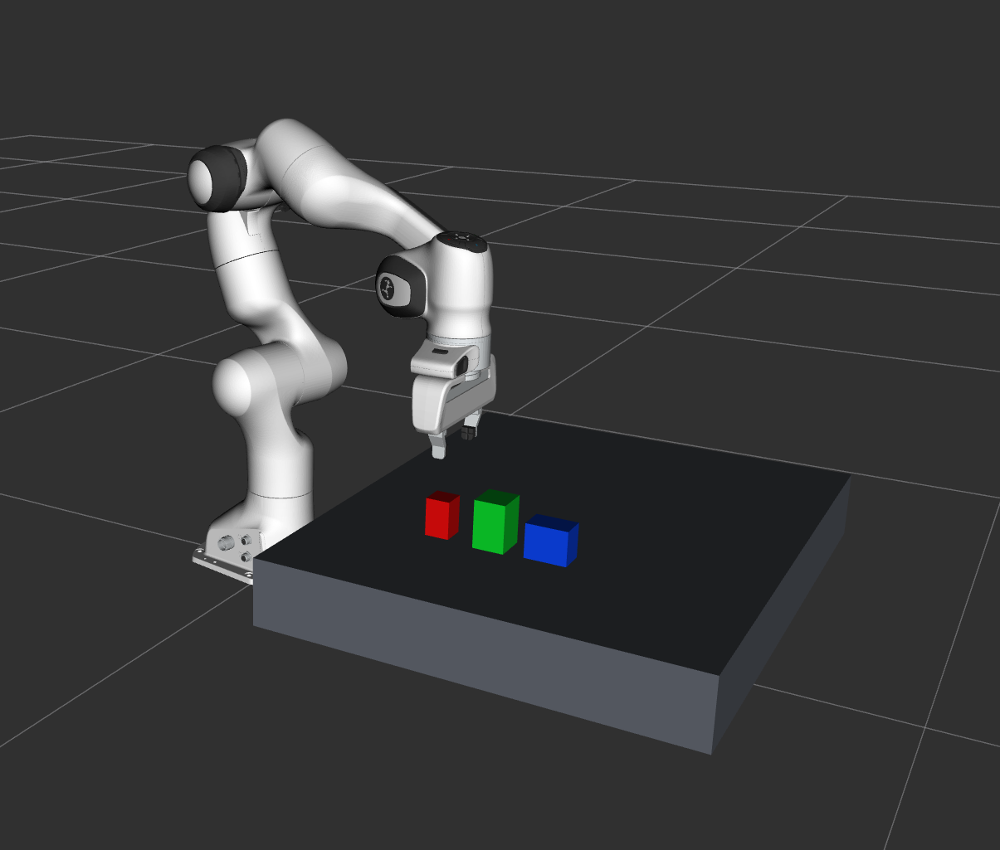
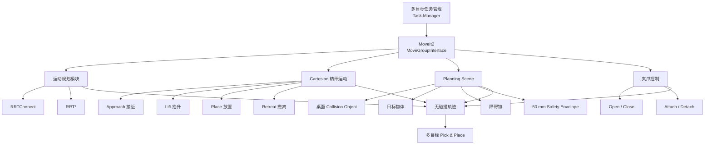
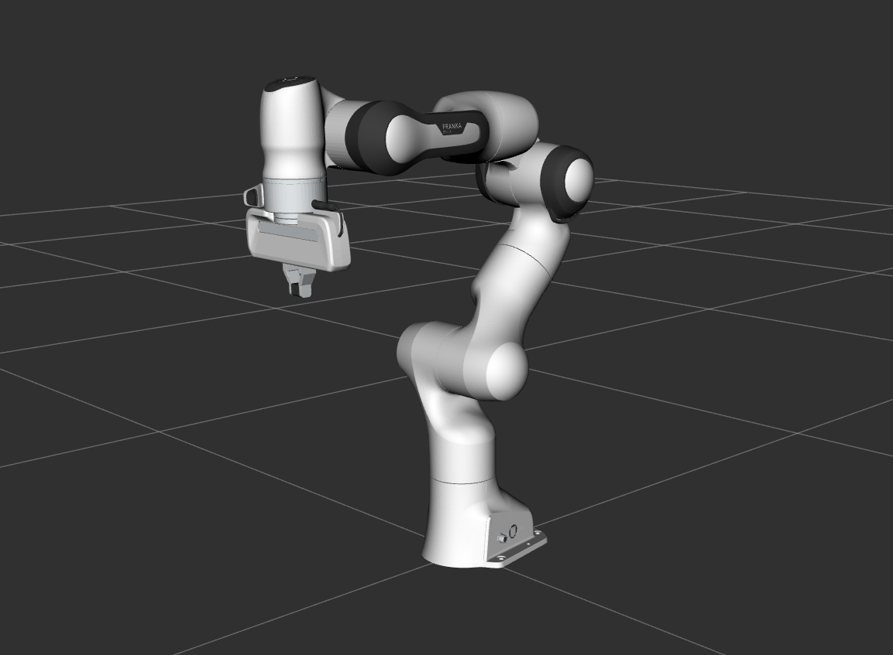
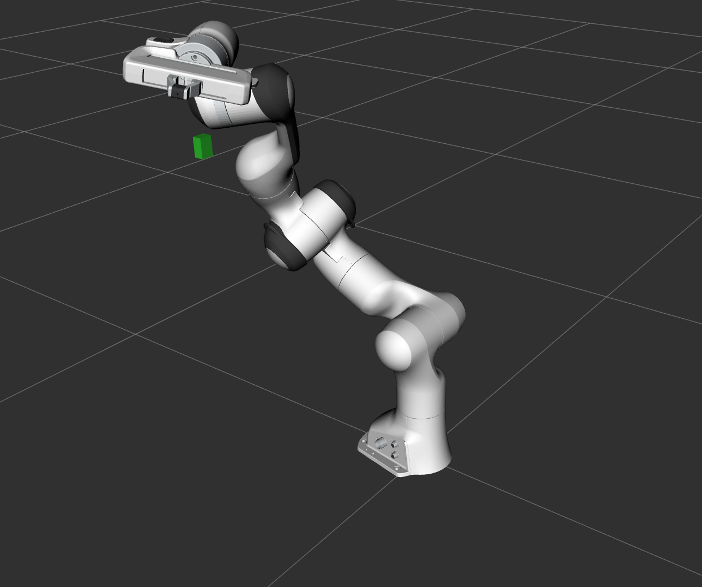
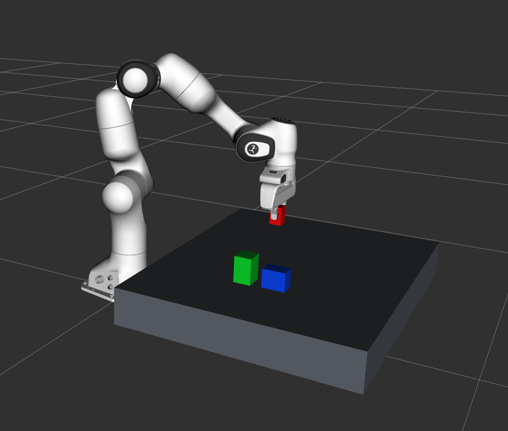
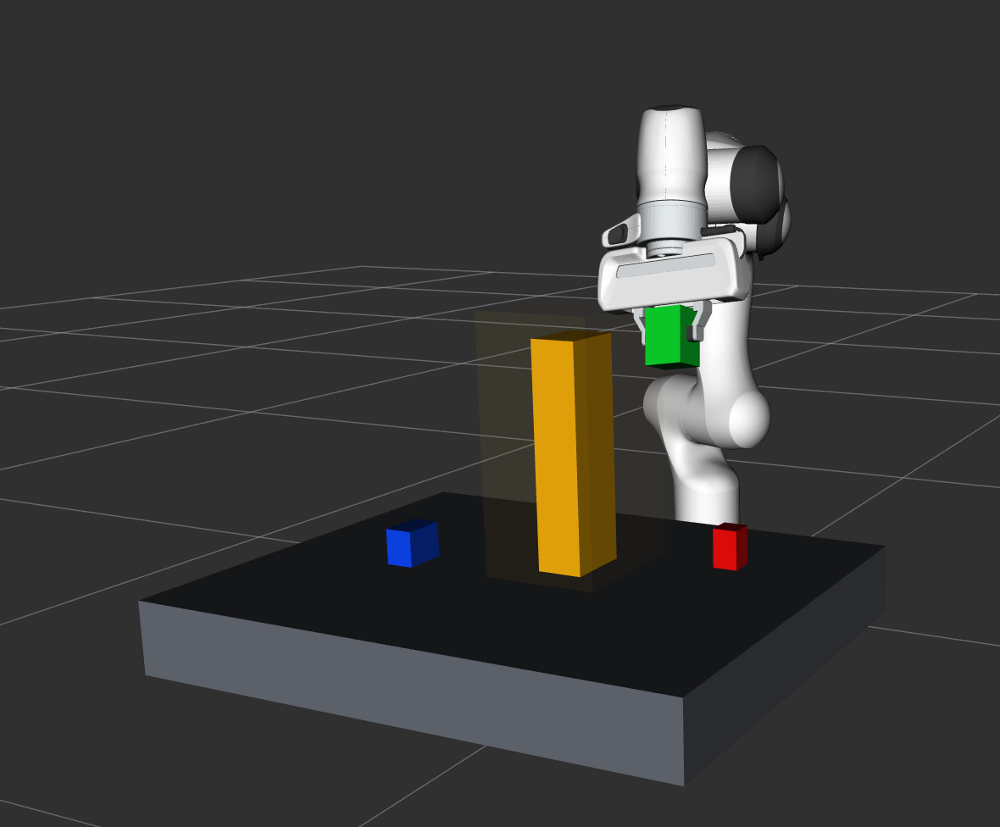
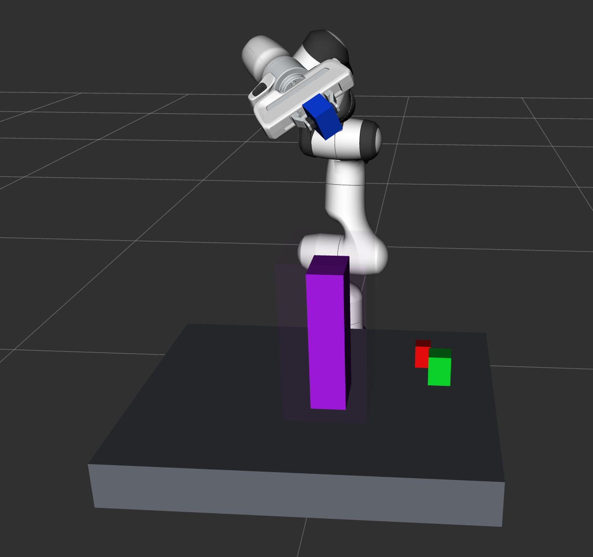
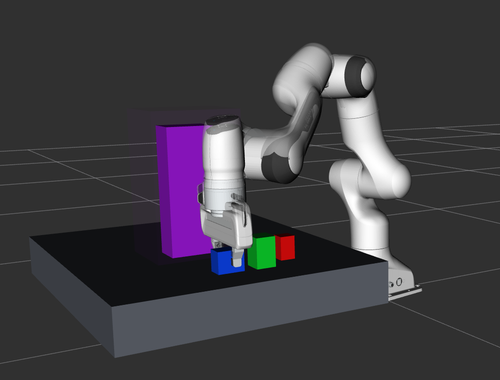
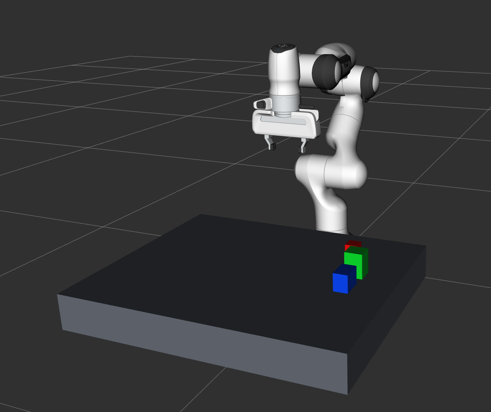

# 基于 ROS2 与 MoveIt2 的机械臂运动规划与多目标抓取仿真系统

<p align="center">
  
</p>

<p align="center">
  <b>图 1  多目标抓取与运动规划仿真场景</b>
</p>

<p align="center">
场景中包含 Franka Panda 机械臂、工作台以及 RED、GREEN、BLUE 三个不同尺寸目标物体。该场景用于后续多目标连续抓取、分类放置以及携物避障任务验证。
</p>

## 1. 项目简介

本项目基于 ROS2 Humble、MoveIt2、OMPL 和 C++，搭建 Franka Panda 机械臂运动规划与抓取仿真系统。

项目主要实现了机械臂基础运动规划、Cartesian 末端轨迹控制、障碍物避障、单目标抓取以及多目标连续抓取与分类放置等功能。

在多目标任务中，设置三个不同颜色、不同尺寸的目标物体，并在第二、第三个任务中加入障碍物。机械臂在抓取物体后，通过 RRTConnect 或 RRT* 重新规划无碰撞路径，实现携带物体状态下的避障搬运。

最终三个多目标任务全部成功完成。


## 🎬 项目演示视频

本视频展示 Franka Panda 机械臂在 MoveIt2 Fake Hardware 环境下完成多目标连续 Pick & Place 任务的完整过程，包括：

- RED、GREEN、BLUE 三个不同尺寸目标物体的连续抓取与放置；
- Pre-Grasp 与分段 Cartesian Approach；
- Attached Collision Object 携物碰撞检测；
- Task-2 与 Task-3 障碍物场景下的无碰撞路径重新规划；
- 50 mm Safety Envelope 安全碰撞包络；
- RRTConnect / RRT* 候选轨迹规划；
- 任务完成后返回 Safe Home。

▶️ [点击查看完整运行演示](videos/multi_pick_and_place_demo.mp4)

> 注：RRTConnect 与 RRT* 属于随机采样式规划算法，因此不同运行过程中具体轨迹、规划时间和所选择的规划器可能存在差异。

## 2. 开发环境

| 项目 | 配置 |
|---|---|
| 操作系统 | Ubuntu 22.04 / WSL2 |
| ROS版本 | ROS2 Humble |
| 机械臂模型 | Franka Emika Panda |
| 运动规划框架 | MoveIt2 |
| 路径规划库 | OMPL |
| 路径规划算法 | RRTConnect、RRT* |
| 编程语言 | C++17 |
| 构建工具 | CMake、colcon |
| 可视化工具 | RViz2 |
| 硬件模式 | MoveIt2 Fake Hardware |

> 当前项目基于 MoveIt2 Fake Hardware 完成运动规划与抓取仿真，实验中的定位误差为仿真结果，不代表实体机械臂的实际精度。

## 3. 系统架构

本项目采用 ROS2 与 MoveIt2 构建机械臂运动规划系统。上层任务管理模块负责多目标抓取流程控制，MoveIt2 负责运动规划、碰撞检测及机械臂轨迹执行。



系统整体流程为：

**任务管理 → MoveIt2 运动规划 → 碰撞检测 → 轨迹执行 → 夹爪抓取/释放 → 多目标连续搬运。**

## 4. 项目功能模块

### 4.1 基础运动规划

基于 MoveIt2 的 `MoveGroupInterface` 获取机械臂当前状态，并设置末端执行器目标位姿，通过 OMPL 自动生成从当前构型到目标构型的无碰撞运动轨迹。

基础运动规划流程为：

```text
Current Robot State
        ↓
Target End-Effector Pose
        ↓
MoveIt2 Motion Planning
        ↓
Trajectory Execution
        ↓
Target Reached
```

该模块用于验证 Panda 机械臂模型、MoveIt2 规划接口以及轨迹执行控制器是否能够正常工作，并为后续 Waypoint 控制、Cartesian 轨迹和抓取任务提供基础。

<p align="center">
  
</p>

<p align="center">
  <b>图 2  Panda 机械臂基础目标位姿运动规划</b>
</p>

<p align="center">
机械臂通过 MoveIt2 从当前构型规划至指定末端目标位姿，用于验证 MoveGroupInterface、OMPL 规划以及轨迹执行链路是否能够正常工作。
</p>

### 4.2 Waypoint 多点运动控制

在基础位姿控制的基础上，设置多个目标位姿，使机械臂依次经过多个 Waypoint，实现连续多点运动。

运动流程为：

```text
Safe Home
   ↓
Point A
   ↓
Point B
   ↓
Point C
   ↓
Safe Home
```

该模块主要用于验证机械臂连续任务执行能力，并为后续多阶段抓取任务中的接近、搬运和返回过程提供基础。

### 4.3 障碍物避障规划

通过 MoveIt2 的 `PlanningSceneInterface` 在规划场景中加入障碍物，并使用 OMPL 中的 RRTConnect 和 RRT* 进行无碰撞路径规划。

其中：

- **RRTConnect**：采用双向快速扩展随机树，搜索速度快，适合快速寻找可行路径。
- **RRT\***：在随机树扩展过程中进行父节点选择和重连，可在增加采样时间后逐步改善路径质量。

本项目采用关节空间累计路径长度作为轨迹评价指标：

$$
L=\sum_{k=1}^{N-1}\left\|q_{k+1}-q_k\right\|_2
$$

在有限规划时间内生成多条可行轨迹，并从中选择关节空间路径长度较短的无碰撞轨迹执行。

> 本项目不将所选轨迹描述为全局最优路径，而是在有限规划时间内生成的可行候选轨迹中进行比较和选择。

<p align="center">
  
</p>

<p align="center">
  <b>图 3  Planning Scene 中的障碍物避障规划场景</b>
</p>

<p align="center">
在机械臂运动路径附近加入 Collision Object，对原始无障碍路径形成阻挡，并通过 RRTConnect 与 RRT* 搜索新的无碰撞轨迹，用于验证静态障碍场景下的重新规划能力。
</p>

### 4.4 Cartesian Path 末端轨迹控制

为实现机械臂末端执行器的直线运动，本项目使用 MoveIt2 的 Cartesian Path 功能进行笛卡尔空间轨迹规划。

与普通关节空间规划不同，Cartesian Path 直接对末端执行器的空间位姿进行插值，使机械臂末端能够沿指定方向完成近似直线运动。

本项目设计了如下三段 Cartesian 轨迹：

```text
当前位置
   ↓
Z 方向下降 0.15 m
   ↓
X 方向移动 0.15 m
   ↓
Z 方向上升 0.15 m
```

总几何路径长度约为：

$$
L_{cart}=0.15+0.15+0.15=0.45\,m
$$

Cartesian Path 使用的末端插值步长为：

$$
\Delta s=0.005\,m
$$

实验中三段轨迹均成功完成，Cartesian Fraction 达到 100%，说明所设置的末端路径可以完整生成并执行。

该模块主要用于后续抓取任务中的精细运动，例如：

- 抓取前垂直接近目标物体；
- 抓取完成后的垂直抬升；
- 放置过程中的垂直下降；
- 放置完成后的安全撤离。


### 4.5 单目标 Pick & Place

在基础运动规划和 Cartesian Path 的基础上，本项目进一步实现单目标抓取与放置任务。

抓取任务采用 MoveIt2 Planning Scene 对目标物体进行建模，并通过夹爪控制、Cartesian 末端运动以及 Attached Collision Object 机制完成完整的 Pick & Place 流程。

整体执行流程如下：

```text
Open Gripper
      ↓
Move to Safe Home
      ↓
Move to Pre-Grasp
      ↓
Cartesian Approach
      ↓
Close Gripper
      ↓
Attach Object
      ↓
Cartesian Lift
      ↓
Transfer to Pre-Place
      ↓
Cartesian Descend
      ↓
Open Gripper
      ↓
Detach Object
      ↓
Cartesian Retreat
      ↓
Return Safe Home
```

其中，抓取阶段首先控制机械臂运动至目标物体上方的 Pre-Grasp 位姿，然后通过 Cartesian Path 沿 Z 方向缓慢下降至抓取位置。

夹爪闭合后，目标物体通过 MoveIt2 的 Attached Collision Object 机制与机械臂末端建立关联，使目标物体在后续搬运过程中能够随机械臂同步运动，并参与 Planning Scene 中的碰撞检测。

完成抓取后，机械臂首先沿竖直方向抬升目标物体，再通过运动规划到达目标放置区域上方，随后使用 Cartesian Path 完成垂直下降、释放物体以及安全撤离。

单目标抓取实验中，各阶段均成功完成：

| 阶段 | 结果 |
|---|---:|
| Pre-Grasp | SUCCESS |
| Cartesian Approach | 100% |
| Gripper Close | SUCCESS |
| Attach Object | SUCCESS |
| Cartesian Lift | 100% |
| Transfer | SUCCESS |
| Place Descend | 100% |
| Gripper Open | SUCCESS |
| Detach Object | SUCCESS |
| Retreat | 100% |
| Return Home | SUCCESS |

最终放置误差约为：

$$
e_{place}=0.105\,mm
$$

该结果为 MoveIt2 Fake Hardware 环境下的仿真结果，用于验证运动规划、抓取流程和 Planning Scene 物体附着/分离逻辑，不代表实体机械臂的真实抓取精度。

通过该模块，完成了从单纯机械臂运动规划到完整“接近—抓取—搬运—放置”任务流程的过渡，并为后续多目标连续抓取与携物避障任务提供基础。


### 4.6 多目标连续抓取与携物避障

在单目标 Pick & Place 的基础上，本项目进一步设计了多目标连续抓取与分类放置任务。

实验场景中设置三个颜色和尺寸均不同的目标物体：

| Task | Color | Object Size |
|---|---|---|
| Task-1 | RED | 35 × 35 × 55 mm |
| Task-2 | GREEN | 45 × 50 × 70 mm |
| Task-3 | BLUE | 60 × 40 × 50 mm |

三个任务按照顺序连续执行，其中 Task-1 为无障碍基础抓取任务，Task-2 和 Task-3 在物体搬运路径中加入障碍物，用于验证机械臂在携带目标物体状态下的避障能力。

<p align="center">
  
</p>

<p align="center">
  <b>图 4  Task-1：RED Object 抓取过程</b>
</p>

<p align="center">
机械臂首先到达 RED Object 上方的 Pre-Grasp 位姿，再通过 Cartesian Path 垂直接近目标物体，并完成夹爪闭合与物体附着，为后续搬运任务做准备。
</p>

整体任务流程为：

```text
Task Start
    ↓
Open Gripper
    ↓
Move to Pre-Grasp
    ↓
Cartesian Approach
    ↓
Close Gripper
    ↓
Attach Object
    ↓
Segmented Cartesian Lift
    ↓
Obstacle Detection / Scene Update
    ↓
Collision-Free Replanning
    ↓
Transfer with Attached Object
    ↓
Cartesian Place Descend
    ↓
Open Gripper
    ↓
Detach Object
    ↓
Cartesian Retreat
    ↓
Next Task
```

为了提高抓取和搬运过程的稳定性，较长的 Cartesian 运动被拆分为多个小段执行，单段运动距离限制为：

$$
\Delta s \leq 25\,mm
$$

在每一小段执行完成后重新获取机械臂状态，从而降低连续长距离 Cartesian 运动过程中状态更新延迟对执行结果的影响。

---

#### 携物碰撞检测

在目标物体被抓取后，通过 MoveIt2 的 Attached Collision Object 机制将物体附着到机械臂末端。

此后进行路径规划时，碰撞检测不仅考虑机械臂自身，还同时考虑机械臂所携带物体的几何尺寸，使抓取后的目标物体能够作为机器人运动系统的一部分参与碰撞检测。

流程为：

```text
Gripper Close
      ↓
Attach Object
      ↓
Robot + Object
作为整体参与碰撞检测
      ↓
Collision-Free Transfer
```

---

#### 障碍物安全包络

为避免机械臂规划路径过于贴近障碍物，在可见障碍物外额外设置安全碰撞包络。

障碍物在 X、Y 方向上的安全距离设置为：

$$
d_{safe}=50\,mm
$$

因此规划器实际避让的不是单纯的可见障碍物，而是：

$$
Obstacle_{safe}
=
Obstacle_{real}
+
Safety\ Envelope
$$

同时，桌面始终作为 Planning Scene 中的 Collision Object，参与整个抓取、抬升、搬运、放置和撤离过程中的碰撞检测。

---

#### 多规划器候选轨迹选择

Task-2 和 Task-3 在直接搬运路径被障碍物阻断后，分别使用 RRTConnect 和 RRT* 生成无碰撞候选轨迹。

<p align="center">
  
</p>

<p align="center">
  <b>图 5  Task-2：GREEN Object 携物状态下绕过黄色障碍物</b>
</p>

<p align="center">
GREEN Object 被抓取后作为 Attached Collision Object 随机械臂共同参与碰撞检测。黄色实体为障碍物，其外围半透明区域表示额外设置的安全碰撞包络。
</p>

<p align="center">
该场景中直接 Cartesian 搬运路径只能完成约 6.19%，随后系统重新搜索无碰撞轨迹并完成携物避障搬运。
</p>


<p align="center">
  
</p>

<p align="center">
  <b>图 6  Task-3：BLUE Object 携物状态下绕过紫色障碍物</b>
</p>

<p align="center">
机械臂抓取 BLUE Object 后，在携物状态下进行重新规划。紫色实体为当前任务障碍物，外围半透明区域为对应的 Safety Envelope。
</p>

<p align="center">
原始直接 Cartesian 搬运路径可执行比例约为 5.31%，随后系统通过采样式运动规划生成新的绕障轨迹并完成搬运。
</p>

<p align="center">
  
</p>

<p align="center">
  <b>图 7  多目标连续任务执行过程</b>
</p>

<p align="center">
前两个目标完成放置后仍保留在 Planning Scene 中，机械臂继续执行第三个目标物体的放置任务，体现 Task-1、Task-2、Task-3 在同一程序中的连续执行过程。
</p>

程序在有限规划时间内生成多条候选路径，并采用关节空间累计路径长度：

$$
L=\sum_{k=1}^{N-1}\left\|q_{k+1}-q_k\right\|_2
$$

作为轨迹评价指标，从可行候选轨迹中选择关节空间路径长度较短的轨迹执行。

---

#### 最终实验结果

| 指标 | Task-1 | Task-2 | Task-3 |
|---|---:|---:|---:|
| Color | RED | GREEN | BLUE |
| Obstacle | No | Yes | Yes |
| Direct Cartesian Fraction | - | 6.19% | 5.31% |
| Approach Fraction | 100% | 100% | 100% |
| Lift Fraction | 100% | 100% | 100% |
| Transfer Planner | RRTConnect | RRT* | RRTConnect |
| Joint Path Length | 1.1487 rad | 3.2500 rad | 2.9026 rad |
| Transfer EE Error | 0.077 mm | 0.097 mm | 0.069 mm |
| Place Fraction | 100% | 100% | 100% |
| Retreat Fraction | 100% | 100% | 100% |
| Placement Error | 0.648 mm | 0.319 mm | 0.121 mm |
| Result | SUCCESS | SUCCESS | SUCCESS |

三个连续任务最终均成功完成：

$$
3/3\ SUCCESS
$$

三组任务的平均放置误差约为：

$$
\bar e_{place}=0.363\,mm
$$

最大放置误差约为：

$$
e_{max}=0.648\,mm
$$

其中 Task-2 和 Task-3 的直接 Cartesian 搬运路径分别只能完成约：

$$
6.19\%
$$

和：

$$
5.31\%
$$

说明障碍物有效阻断了原始直接搬运路径。

随后通过 RRT* 或 RRTConnect 重新规划无碰撞轨迹，机械臂在携带目标物体的状态下成功绕过障碍物并到达目标放置区域。

> 上述定位误差均为 MoveIt2 Fake Hardware 环境下的仿真结果，主要用于验证机械臂运动规划、碰撞检测、物体附着以及多任务执行逻辑，不代表实体机械臂的实际抓取和定位精度。


## 5. 实验结果汇总

本项目分别对基础运动规划、障碍物避障、Cartesian Path、单目标 Pick & Place 以及多目标连续抓取任务进行了验证。

### 5.1 各功能模块实验结果

| 模块 | 关键指标 | 实验结果 |
|---|---|---|
| 基础运动规划 | 目标位姿规划与执行 | SUCCESS |
| Waypoint 控制 | 多目标点连续运动 | SUCCESS |
| 障碍物避障 | 3 个障碍场景重新规划 | 3 / 3 SUCCESS |
| Cartesian Path | 总几何路径约 0.45 m | Fraction = 100% |
| 单目标 Pick & Place | 完整抓取—搬运—放置流程 | SUCCESS |
| 多目标 Pick & Place | 3 个不同目标连续抓取 | 3 / 3 SUCCESS |

---

### 5.2 障碍物避障实验

在末端点到点运动距离为：

$$
1.2203\,m
$$

的长距离规划任务中，分别在无障碍基准轨迹的 40%、60% 和 80% 位置设置障碍物。

障碍物尺寸为：

$$
18\times24\times36\,mm
$$

实验结果如下：

| 场景 | 障碍位置 | 最终规划器 | 路径增长率 | 最大关节误差 | 结果 |
|---|---:|---|---:|---:|---|
| Obstacle-1 | 40% | RRT* | +7.27% | 0.0010 rad | SUCCESS |
| Obstacle-2 | 60% | RRT* | +4.09% | 0.0008 rad | SUCCESS |
| Obstacle-3 | 80% | RRTConnect | +6.38% | 0.0008 rad | SUCCESS |

三个场景中，原始基准轨迹均受到障碍物阻断，而起始构型和目标构型保持有效。重新规划后，机械臂均成功到达相同目标构型。

---

### 5.3 Cartesian Path 实验

设计三段末端 Cartesian 轨迹：

```text
Z_DOWN 0.15 m
      ↓
+X     0.15 m
      ↓
Z_UP   0.15 m
```

总几何路径长度约为：

$$
L=0.45\,m
$$

实验结果：

| 指标 | 结果 |
|---|---:|
| EEF Step | 0.005 m |
| Cartesian Fraction | 100% |
| 执行时间 | 17.5263 s |
| 最终位置误差 | ≈ 0 m |
| Return Home Joint Error | 0.0009 rad |
| Result | SUCCESS |

---

### 5.4 单目标 Pick & Place 实验

| 指标 | 结果 |
|---|---:|
| Approach Fraction | 100% |
| Lift Fraction | 100% |
| Place Descend Fraction | 100% |
| Retreat Fraction | 100% |
| Placement Error | 0.105 mm |
| Return Home | SUCCESS |
| Final Result | SUCCESS |

---

### 5.5 多目标连续抓取实验

| 指标 | Task-1 | Task-2 | Task-3 |
|---|---:|---:|---:|
| Color | RED | GREEN | BLUE |
| Obstacle | No | Yes | Yes |
| Direct Cartesian Fraction | - | 6.19% | 5.31% |
| Approach | 100% | 100% | 100% |
| Lift | 100% | 100% | 100% |
| Transfer Planner | RRTConnect | RRT* | RRTConnect |
| Joint Path Length | 1.1487 rad | 3.2500 rad | 2.9026 rad |
| Transfer EE Error | 0.077 mm | 0.097 mm | 0.069 mm |
| Place | 100% | 100% | 100% |
| Retreat | 100% | 100% | 100% |
| Placement Error | 0.648 mm | 0.319 mm | 0.121 mm |
| Result | SUCCESS | SUCCESS | SUCCESS |

三个任务最终均成功完成：

$$
3/3\ SUCCESS
$$

平均放置误差约为：

$$
\bar e_{place}=0.363\,mm
$$

最大放置误差约为：

$$
e_{max}=0.648\,mm
$$

Task-2 和 Task-3 中，直接 Cartesian 搬运路径分别只能完成约 6.19% 和 5.31%，随后通过采样式运动规划重新搜索无碰撞路径并成功完成携物绕障搬运。

<p align="center">
  
</p>

<p align="center">
  <b>图 8  三个目标连续 Pick & Place 任务完成后的最终场景</b>
</p>

<p align="center">
RED、GREEN、BLUE 三个目标物体均完成指定抓取与分类放置任务，机械臂完成全部任务后返回安全位置。
</p>

<p align="center">
该结果用于验证 MoveIt2 Fake Hardware 环境下多目标连续抓取、携物避障以及分类放置流程的完整性。
</p>

## 6. 项目运行方法

项目运行时需要开启两个终端。

### 6.1 Terminal 1：启动 Panda 与 MoveIt2

首先进入项目目录，并加载 ROS2 和当前工作空间环境：

```bash
cd ~/Robot_Arm_Project

source /opt/ros/humble/setup.bash
source install/setup.bash
```

启动 Panda MoveIt2 Demo：

```bash
ros2 launch moveit_resources_panda_moveit_config demo.launch.py
```

启动成功后，将打开 RViz2，并加载 Panda 机械臂模型、MoveGroup、Fake Hardware Controller 以及相关规划组件。

---


### 6.2 Terminal 2：各功能模块运行指令

Terminal 1 中的 Panda MoveIt2 Demo 保持运行，在新的 Terminal 2 中进入项目目录并加载工作空间环境：

```bash
cd ~/Robot_Arm_Project
source /opt/ros/humble/setup.bash
source install/setup.bash
```

各功能模块对应的运行指令如下：

| 功能模块 | 对应程序 | 运行指令 |
|---|---|---|
| 基础运动规划 | `move_to_pose.cpp` | `ros2 launch arm_control move_to_pose.launch.py` |
| Waypoint 多点运动控制 | `waypoint_control.cpp` | `ros2 launch arm_control waypoint_control.launch.py` |
| 障碍物避障实验 | `obstacle_benchmark.cpp` | `ros2 launch arm_control obstacle_benchmark.launch.py` |
| Cartesian Path | `cartesian_path.cpp` | `ros2 launch arm_control cartesian_path.launch.py` |
| 单目标 Pick & Place | `pick_and_place.cpp` | `ros2 launch arm_control pick_and_place.launch.py` |
| 多目标连续抓取与携物避障 | `multi_pick_and_place_safe_v3.cpp` | `ros2 launch arm_control multi_pick_and_place_safe_v3.launch.py` |

建议按照以下顺序依次体验项目功能：

```text
move_to_pose
      ↓
waypoint_control
      ↓
obstacle_benchmark
      ↓
cartesian_path
      ↓
pick_and_place
      ↓
multi_pick_and_place_safe_v3
```

每个模块运行结束后，可以在 Terminal 2 中使用：

```text
Ctrl + C
```

结束当前节点，再运行下一个模块。Terminal 1 中的 MoveIt2 Demo 一般无需重新启动。

### 6.3 Terminal 2：运行最终多目标抓取任务

重新打开一个终端：

```bash
cd ~/Robot_Arm_Project

source /opt/ros/humble/setup.bash
source install/setup.bash
```

运行最终多目标抓取与避障程序：

```bash
ros2 launch arm_control multi_pick_and_place_safe_v3.launch.py
```

程序将依次执行：

```text
Task-1
RED Object
No Obstacle
      ↓
Pick & Place
      ↓

Task-2
GREEN Object
Yellow Obstacle
      ↓
Collision-Free Replanning
      ↓
Pick & Place
      ↓

Task-3
BLUE Object
Purple Obstacle
      ↓
Collision-Free Replanning
      ↓
Pick & Place
      ↓

Return Safe Home
```

程序运行过程中可以在 RViz2 中观察机械臂抓取、抬升、避障搬运以及放置过程。

---

### 6.4 实验数据

最终多目标任务的实验结果保存在：

```text
~/Robot_Arm_Project/data/multi_pick_and_place_safe_v3_result.csv
```

运行日志保存在：

```text
~/Robot_Arm_Project/multi_pick_and_place_safe_v3.log
```

CSV 文件中记录的主要指标包括：

- Cartesian Approach Fraction
- Cartesian Lift Fraction
- Direct Cartesian Fraction
- Transfer Planner
- Joint-space Path Length
- End-Effector Error
- Placement Error
- Task Execution Time
- Task Success


## 7. 项目目录结构

项目主要目录结构如下：

```text
Robot_Arm_Project/
│
├── src/
│   └── arm_control/
│       │
│       ├── src/
│       │   ├── move_to_pose.cpp
│       │   ├── waypoint_control.cpp
│       │   ├── obstacle_demo.cpp
│       │   ├── obstacle_benchmark.cpp
│       │   ├── cartesian_path.cpp
│       │   ├── pick_and_place.cpp
│       │   └── multi_pick_and_place_safe_v3.cpp
│       │
│       ├── launch/
│       │   ├── move_to_pose.launch.py
│       │   ├── waypoint_control.launch.py
│       │   ├── obstacle_demo.launch.py
│       │   ├── obstacle_benchmark.launch.py
│       │   ├── cartesian_path.launch.py
│       │   ├── pick_and_place.launch.py
│       │   └── multi_pick_and_place_safe_v3.launch.py
│       │
│       ├── CMakeLists.txt
│       └── package.xml
│
├── data/
│   ├── three_stable_obstacles.csv
│   ├── cartesian_path_result.csv
│   ├── pick_and_place_result.csv
│   └── multi_pick_and_place_safe_v3_result.csv
│
├── build/
├── install/
├── log/
│
└── README.md
```

各主要文件功能如下：

| 文件 | 功能 |
|---|---|
| `move_to_pose.cpp` | 基础目标位姿运动规划 |
| `waypoint_control.cpp` | 多 Waypoint 连续运动控制 |
| `obstacle_benchmark.cpp` | 障碍物避障与 RRTConnect / RRT* 对比实验 |
| `cartesian_path.cpp` | Cartesian 末端直线轨迹控制 |
| `pick_and_place.cpp` | 单目标抓取与放置 |
| `multi_pick_and_place_safe_v3.cpp` | 最终多目标连续抓取与携物避障 |
| `launch/` | 各功能模块对应的 ROS2 Launch 文件 |
| `data/` | 实验结果 CSV 数据 |
| `CMakeLists.txt` | C++ 程序编译配置 |
| `package.xml` | ROS2 功能包依赖配置 |


## 8. 项目亮点

本项目不仅完成了机械臂基础运动规划，还进一步实现了多目标连续抓取、携物避障以及安全碰撞约束，形成了较完整的机械臂任务执行流程。

### 8.1 多规划器联合规划

项目同时使用 RRTConnect 和 RRT* 进行候选路径搜索，并在有限规划时间内生成多条可行轨迹。

通过关节空间累计路径长度：

$$
L=\sum_{k=1}^{N-1}\left\|q_{k+1}-q_k\right\|_2
$$

对候选轨迹进行评价，并选择路径长度较短的可行轨迹执行。

这种方式避免了始终固定使用单一规划器，可以根据具体场景选择更合适的规划结果。

---

### 8.2 携物状态下的碰撞检测

目标物体抓取后，通过 MoveIt2 Attached Collision Object 机制附着到机械臂末端。

此后，目标物体会随机械臂一起参与 Planning Scene 中的碰撞检测，从而实现：

```text
Robot Collision Checking
        ↓
Robot + Attached Object
        ↓
Collision-Free Transfer
```

这使系统不仅考虑机械臂本体避障，还能够考虑抓取物体本身与障碍物之间的碰撞关系。

---

### 8.3 障碍物安全包络

为了避免机械臂规划路径过于贴近障碍物，在真实障碍物外围额外设置安全碰撞区域。

安全距离设置为：

$$
d_{safe}=50\,mm
$$

因此运动规划实际避让区域大于可见障碍物尺寸，从而为机械臂和携带物体保留额外安全余量。

---

### 8.4 分段 Cartesian 运动

抓取、抬升、放置和撤离阶段使用 Cartesian Path 完成精细末端运动。

对于较长的 Cartesian 轨迹，将其拆分为多个小段执行，单段距离限制为：

$$
\Delta s \leq 25\,mm
$$

每一段执行完成后重新获取机械臂状态，从而提高连续精细运动过程中的稳定性。

---

### 8.5 多目标连续任务

最终系统能够连续完成三个不同颜色、不同尺寸目标物体的抓取与分类放置任务。

任务执行过程中无需人工重新启动程序，而是自动完成：

```text
Task-1
   ↓
Task-2
   ↓
Task-3
   ↓
Return Safe Home
```

最终三个任务全部成功完成：

$$
3/3\ SUCCESS
$$

---

### 8.6 直接路径阻断验证

在 Task-2 和 Task-3 中，障碍物并非单纯用于场景展示，而是实际阻断了原始直接 Cartesian 搬运路径。

实验结果中：

$$
Task\mbox{-}2 = 6.19\%
$$

$$
Task\mbox{-}3 = 5.31\%
$$

随后分别通过 RRT* 和 RRTConnect 搜索新的无碰撞搬运轨迹，并成功到达目标区域。

因此该实验能够较直观地体现障碍物加入前后路径规划结果的变化。


## 9. 项目局限与后续改进

虽然本项目已经完成了机械臂运动规划、障碍物避障、单目标抓取以及多目标连续抓取等功能，但当前系统仍存在一定局限。

### 9.1 当前局限

1. **基于 Fake Hardware 仿真环境**

   当前项目主要在 MoveIt2 Fake Hardware 环境下进行验证，未接入真实 Franka Panda 机械臂。

   因此实验中的末端误差、放置误差以及轨迹执行精度主要反映仿真环境下的规划与执行结果，不能直接代表实体机械臂的真实控制精度。

2. **抓取过程未考虑真实接触与力控制**

   当前夹爪抓取主要通过夹爪开合指令以及 Attached Collision Object 机制模拟物体抓取。

   系统暂未涉及真实接触力、摩擦、夹持稳定性以及力矩传感器反馈。

3. **障碍物为静态场景**

   当前 Planning Scene 中的障碍物位置在任务执行前已经确定，属于静态障碍物避障。

   系统暂未实现动态障碍物检测、在线环境感知以及实时轨迹重规划。

4. **目标物体位置为预设值**

   当前抓取目标的位置和尺寸均由程序预先设定，尚未接入相机、深度传感器或目标检测算法进行自动识别与定位。

5. **实验次数有限**

   当前实验主要用于验证各功能模块及完整任务流程是否能够成功执行。

   若进一步用于论文级或工程级性能评估，还需要增加重复实验次数，并统计成功率、平均规划时间、路径长度以及误差方差等指标。

---

### 9.2 采样式规划的随机性与可复现性

本项目中的 RRTConnect 和 RRT* 均属于基于随机采样的运动规划算法。

因此，即使机械臂的起始状态、目标位姿、障碍物位置以及规划参数保持不变，不同运行过程中生成的搜索树、规划时间和最终轨迹仍可能存在差异。

在部分较复杂的障碍场景中，规划器可能在设定时间内无法找到满足碰撞约束的可行路径，从而出现规划超时或单次任务失败的情况。

典型表现包括：

```text
Planning request accepted
        ↓
Sampling-based Planning
        ↓
找到可行路径
        ↓
SUCCESS

或

Planning request accepted
        ↓
Sampling-based Planning
        ↓
限定时间内未找到可行路径
        ↓
TIMEOUT / FAILED
```

### 9.3 后续改进方向

后续可从以下几个方向进一步扩展：

- 接入 RGB-D 相机，实现目标物体检测与三维定位；
- 引入 MoveIt Task Constructor，对复杂抓取任务进行分阶段任务规划；
- 接入 Gazebo 或 Isaac Sim，提高抓取接触和物理仿真的真实性；
- 增加动态障碍物检测与在线轨迹重规划能力；
- 引入力控制或阻抗控制，提高机械臂抓取过程的安全性；
- 接入真实 Franka Panda 或其他机械臂进行实机验证；
- 增加轨迹平滑、时间参数化以及运动效率优化；
- 对 RRTConnect、RRT* 等规划算法开展更系统的性能对比实验。

通过以上改进，可以进一步将当前项目由运动规划仿真平台扩展为包含感知、规划、控制和执行的完整机械臂自主操作系统。


## 10. 项目总结

本项目基于 ROS2 Humble、MoveIt2、OMPL 和 C++17，完成了 Franka Panda 机械臂运动规划与多目标抓取仿真系统的设计与实现。

项目从基础运动规划开始，逐步完成了：

```text
基础位姿规划
      ↓
Waypoint 多点运动
      ↓
障碍物避障
      ↓
Cartesian Path
      ↓
单目标 Pick & Place
      ↓
多目标连续抓取
      ↓
携物状态下的避障搬运